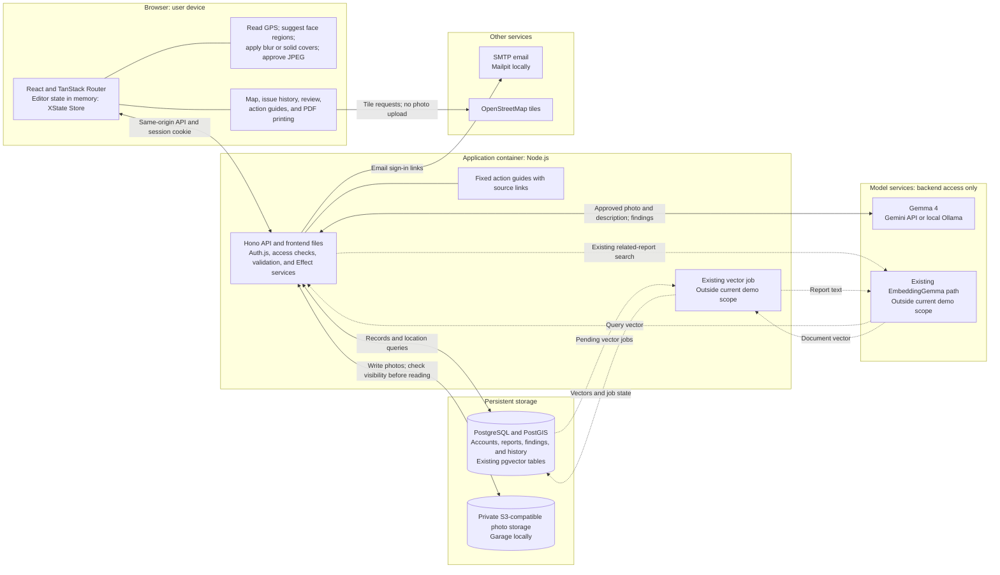
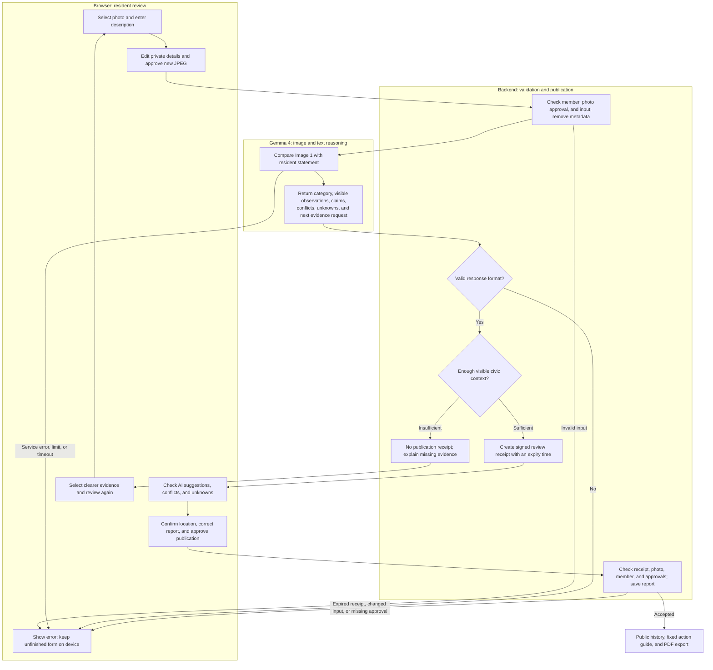

# CivicLens

CivicLens helps residents report pedestrian safety issues, accessibility barriers, and potholes in Bengaluru. Residents review the photo, AI findings, and public report before publication.

**Track 1: Best Use of Gemma 4 — G3. Multimodal AI Intelligence.**

Gemma 4 compares a photo with the resident's text description. Image and text are the input formats for this demo. Audio is outside the current scope.

## Quick stack summary

| Part | Technology |
| --- | --- |
| Frontend | React, TypeScript, Vite, TanStack Router |
| Interface | Tailwind CSS, shadcn/ui, XState Store |
| Backend | Hono on Node.js, Effect v4 |
| Accounts | Auth.js, Drizzle adapter, email links |
| Database | PostgreSQL, PostGIS, Drizzle migrations |
| Photo review | Browser canvas, MediaPipe face suggestions |
| AI review | Gemma 4 through Gemini API or local Ollama |
| Map | Leaflet, OpenStreetMap tiles |
| Photo storage | Private S3-compatible storage; Garage locally |
| Report export | Print layout and browser PDF export |
| Development | PNPM workspaces, Docker, Vitest, ESLint, Knip |
| Existing search code | EmbeddingGemma and pgvector; outside the current demo |

The frontend uses the requested [shadcn preset](https://ui.shadcn.com/create?preset=b27GcrRo). It uses Base UI Rhea, neutral colours, Inter, and Lucide. The lockfile fixes package versions.

## Product principle: invisible utility

**The best use of artificial intelligence is invisible utility.**

This principle guides the interface. G3 remains the primary problem statement.

Keep useful AI help inside the reporting task. The resident prepares a photo, reviews the findings, and publishes a report with useful next steps. There is no separate chatbot.

Show AI suggestions, uncertainty, and failures. Require final human approval. AI does not verify an incident or promise government action.

## Architecture

One application container serves the frontend files and backend API. The browser runs the interface. The database, photo storage, and model services run outside this container. Public deployment is pending.



Dashed links show existing embedding code outside the current demo. They do not mean that this code is disabled. The backend still checks for vector jobs every 15 seconds.

Original photos and unused photo GPS stay on the device. The backend receives the approved copy and required report details. PostgreSQL stores published content, AI findings, and history. Private object storage holds approved photos. The backend checks visibility before it serves a photo. API keys stay on the backend.

## How Gemma 4 is used

The backend sends the approved photo and resident description in one request. Gemma compares both inputs. It returns a category, visible observations, resident claims, conflicts, unknowns, and a request for more evidence.

The resident confirms the location. Gemma does not infer or verify GPS. The backend checks the response format. A correct format does not prove that the findings are true.



For example, a resident can describe a path as completely blocked. The photo can show only part of that path. Gemma must separate the claim from visible evidence and explain what remains unknown. This example is a demo target. It is not a measured accuracy result.

### Success and failure criteria

These are project acceptance criteria. They are not an official judging rubric. A safe rejection can be a successful system result.

| Check | Success criterion | Failure criterion |
| --- | --- | --- |
| Image and text | Gemma uses the photo to suggest a supported category. It compares the photo with the description. | It selects a category from text alone, ignores the photo, or invents visible details. |
| Conflicting claims | It separates claims from observations. It states what the available view cannot establish. | It repeats an unsupported claim as an observed fact. |
| Insufficient evidence | Blank, unrelated, text-only, or unclear input returns an insufficient result. There is no category or publication receipt. The response requests useful evidence. | The system permits publication from an insufficient review or invents civic context. |
| Human control | The response avoids claims about permits, legal violations, exact measurements, and verified repairs. The resident checks the final report. | The response claims verification, or the system publishes without final human approval. |
| Service or output failure | Invalid JSON, invalid fields, timeout, provider failure, and service limits produce a clear error. No successful receipt is created. | A service failure is shown as successful analysis, or fake model output is used. |
| Review receipt | A new publication requires a valid receipt for the member, photo, original description, model, and findings. | Another member or changed analyzed input can reuse the receipt. An expired or forged receipt is accepted. |

Local tests have used real Gemma, PostgreSQL, and private S3 storage. Automated tests check response validation, insufficient evidence, review receipts, privacy, provider errors, and retry limits. These tests do not establish broad model accuracy. Category quality and conflicting claims still need selected demo cases. Long-term hosted reliability is not established.

Keep model findings separate from reviewed content. Do not use an **AI verified** label. Fixed action guides use checked source links. Gemma does not create government procedures or submit complaints.

## Case follow-up workflow

A coordinator can manage a case from its issue page. Sign in with the local admin account, `admin@civiclens.test`. Open the email link in Mailpit. Demo visitors cannot change case progress.

The stages are Not assigned, Assigned internally, Sent to authority, Acknowledgement reported, Work in progress reported, Resolution reported, Case closed after review, and Reopened. The server checks each stage change.

Record the authority or service, public follow-up owner, source link, and update note. Sent, acknowledged, and work-in-progress stages also require a complaint reference and handoff date. The coordinator must check the responsible agency. CivicLens does not select jurisdiction or send a government complaint.

Resolution, closure, and reopening require public later photo evidence from the same issue. Reopening must use different evidence from the previous case update. Case closure is a coordinator decision; it does not prove official closure. Each update has a server date and a public history entry. A revision check rejects stale updates. The PDF includes case progress and history.

Members can upvote an issue separately from a dated observation. One account has one active upvote per issue. Demo browser identities do not prove unique people.

The report form has a separate Take photo on phone control. It requests the rear camera on supported phones. The gallery control remains available. Both paths use the same privacy review. Camera behaviour still needs a real-phone check.

For a local case workflow check, enable demo mode, start the app and services, then run:

```sh
pnpm --filter @civiclens/backend test:cases
```

This check uses real admin email sign-in, PostgreSQL, and private S3 storage. It checks stage changes, evidence links, history, upvotes, access, and stale updates. It creates labelled synthetic fixtures and hides its test issue afterwards. It does not contact an authority or make AI calls. The normal AI smoke test remains separate.

## EmbeddingGemma status

EmbeddingGemma is not part of the current demo. The code still contains a related-report button, an API route, a model adapter, vector jobs, and pgvector tables. Earlier local tests used this path. That test history does not mean that the current demo uses it.

The core Gemma 4 flow does not require this search. A user can publish a new issue without it. Removal can keep photo review, image-and-text reasoning, publication, the map, history, community actions, and PDF export.

Remove the UI search controls, API route, model settings, vector job timer, and vector writes together. Update the smoke test and documentation. Keep applied database migrations and existing data during this change. Remove unused database objects later with a separate migration. No embedding code has been removed yet.

## Run locally

Requirements: Node.js 22.12 or later, PNPM 12.4.1, and a running Docker-compatible engine.

```sh
pnpm install --frozen-lockfile
pnpm setup:local
pnpm services:up
pnpm db:migrate
pnpm db:seed
pnpm dev
```

Open <http://localhost:5173>. The backend uses port 3000. The local test mailbox is at <http://localhost:8025>.

Setup creates an ignored `.env` with local secrets. It downloads the face model and WASM files. It does not replace an existing `.env`. Local volumes retain data. Do not remove them unless you intend to delete that data.

For normal sign-in, use `reporter@civiclens.test` or `community@civiclens.test`. Open the email in the local mailbox. Follow the verification link. The seed command also creates an admin account. The account list is in `apps/backend/src/seed.ts`. There are no passwords. The seed command refuses to run in production.

For temporary hackathon access, set `DEMO_MODE=true` and restart the backend. Each visitor browser receives a separate 24-hour demo session. No email sign-in is needed. New demo issues have a demo label. Privacy checks, review, and final approval still apply. Admin actions require a real email session with the admin role. Use `/sign-in` for admin access.

The default value is `DEMO_MODE=false`. Set it back to `false` and restart to stop demo access. This does not delete demo reports or photos. Use a separate demo database.

## Services and limits

Auth.js stores account sessions in PostgreSQL through the Drizzle adapter. Sign-up creates an account after email verification. Mailpit captures local email. Configure a production SMTP service before deployment. Public issue responses exclude private account fields.

Auth.js uses a separate database client. Raw location and vector queries use another client because Drizzle changes JSON encoding. Migrations enable PostGIS and pgvector. The initial service area is a Bengaluru demo rectangle. Its production boundary still needs validation.

Set `MODEL_PROVIDER=gemini` for hosted Gemma. Keep `GEMINI_API_KEY` in the backend environment. The default local provider uses `gemma4:12b-mlx` through Ollama. Local input has a longest edge of 512 pixels by default. Set `OLLAMA_IMAGE_SIZE` to change this limit. Smaller input can lose detail. The approved storage photo keeps its larger size.

Hosted checks on 17 October 2026 used `gemma-4-26b-a4b-it`. A full API check and a mobile-browser submission passed. A later blank-image check failed. The adapter retries HTTP 500, 502, 503, or 504 once within the original time limit. It does not retry HTTP 429. Invalid output, billing errors, permission errors, and quota errors fail with an error. There is no fake AI or automatic model fallback.

Garage provides local S3-compatible storage. Its port is bound to loopback. Buckets are private. The backend serves photos after visibility checks. Store permanent data outside the application container.

## Privacy and reliability

Photo edits run on the device. Face suggestions use strong blur. Manual regions start as solid covers. Each region has an effect selector. Both effects change the exported JPEG pixels. If blur is unavailable, use a solid cover. Blur can leave identifying details visible. Use a solid cover when needed. Review the exact exported copy before upload.

The browser exports a new JPEG. The server also removes source metadata before AI review and storage. Detection can miss private details. These checks do not certify complete privacy.

There are no server drafts. A refresh or closed tab can lose unfinished work. Insufficient evidence has no category and cannot be published. Replace the photo and run review again.

A signed review receipt links the member, approved photo, original description, model, and findings. It has an expiry time. The final write checks this receipt. Reviewed text stays separate from model findings. Repeated submissions use an idempotency key to prevent duplicate writes.

Support and dated observations are separate records. Admin visibility changes do not establish resolution. Hidden photos stop being served. Previously downloaded photos and PDFs cannot be recalled.

Uploads have an 8 MB limit and a 20-megapixel limit. Request limits apply within each backend process. Before public deployment, check retention, deletion, SMTP, secrets, backups, model privacy terms, and accessibility. Add shared rate limits if more backend instances are used.

OpenStreetMap tiles require attribution and caching. There is no offline tile download, address autocomplete, or place search in this MVP.

## Checks

```sh
pnpm check:unused
pnpm lint
pnpm typecheck
pnpm test
pnpm build
```

Tests check privacy export, changed photos, withdrawn approval, failed export, blur fallback, metadata removal, and input limits. Backend tests also check review receipts, expired receipts, changed inputs, cross-origin writes, and access checks.

Editor and print tests use a simulated browser. They do not confirm physical-device behaviour or PDF page breaks. Inspect the saved PDF separately.

For a live local smoke test, start the app and services. Use the included CC0 reference image. Its source and usage limits are in `fixtures/README.md`.

```sh
TEST_IMAGE="$PWD/fixtures/road-damage.jpg" pnpm --filter @civiclens/backend test:smoke
```

The current runner still requires EmbeddingGemma. It also uses real email sign-in, the configured Gemma provider, PostgreSQL, and Garage. It creates a test issue, adds evidence and community actions, checks access, and hides the issue. Use only the local development database.

For hosted Gemma, the runner waits five seconds before each review. Set `TEST_AI_GAP_MS` from 5000 to 900000 to increase the wait. Run one live test process at a time. This wait does not guarantee compliance with provider quotas. Normal automated tests use simulated provider responses. Tests do not print email links or session cookies.

## Container build

```sh
docker build -t civiclens .
```

The image contains the frontend build and Hono server. Keep the database, object storage, and model runtimes outside it. Apply migrations before startup. Supply production secrets at runtime. The application rejects the default development secret in production. No hosted resource has been created.

## Workspace and development record

| Folder | Content |
| --- | --- |
| `apps/frontend` | Browser interface |
| `apps/backend` | API, account checks, model adapters, and storage access |
| `packages/shared` | Request schemas, public types, and fixed action guides |
| `infra` | Local PostgreSQL and Garage settings |

The development window is 13–18 October 2026. This project uses AI coding assistance. Git tracking started on 15 October 2026. The first commits group existing local work by area. They do not state when each feature was written. No commit dates were changed. The `frontend-scaffold` branch keeps the generated frontend starter commit.

See [WORKFLOW.md](WORKFLOW.md) for agreed decisions and remaining checks.
