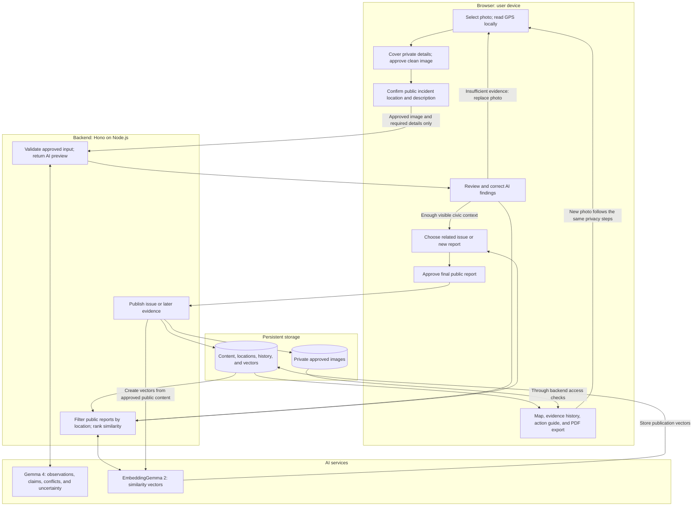
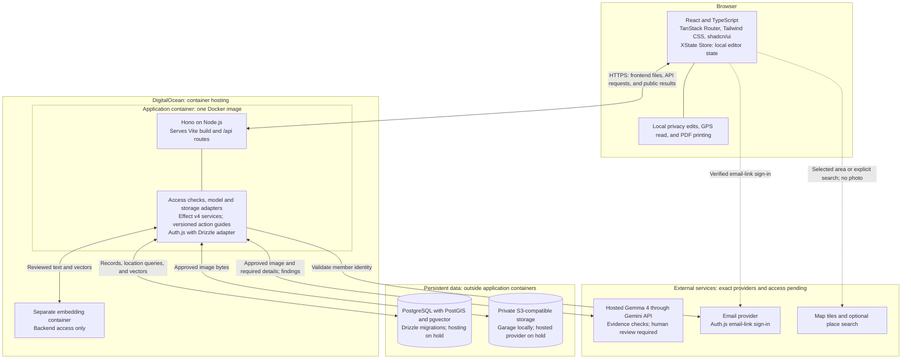

# CivicLens: workflow and architecture

Updated: 18 October 2026. Status: local MVP implemented. Public deployment is pending.

Keep agreed decisions in this file. Keep exploration and alternatives in the project chat.

## Product principle: invisible utility

**The best use of artificial intelligence is invisible utility.**

Lead with the resident's task: report a problem, review evidence, find related reports, and share useful next steps. Keep AI help inside this flow. Do not add a separate chatbot or make users choose a model to report an issue.

Use task names for primary actions, such as Review evidence. Keep AI labels, processing disclosures, uncertainty, failures, and final human approval visible. Keep model names and architecture details in privacy information and technical documentation. The theme changes presentation; it does not establish verification, automate publication, or expand the MVP.

## Workflow overview

The original photo stays on the device. Only the approved image can leave the browser.

## Scope

- **Area:** Bengaluru first; design for later use in India.
- **Categories:** pedestrian safety, accessibility barriers, and potholes. Use one primary category and optional impact labels.
- **Event:** Hacktoberfest Hack Day Bengaluru 2026; Gemma 4 G3 multimodal track.
- **Dates:** development from 13–18 October 2026. The supplied handbook gives a tentative deadline of 18 October, 3:30 PM IST. Check organizer updates.
- **Submission:** public GitHub source, an open-source license, and a working public deployment.
- **Language:** English only for the MVP. Kannada support is deferred.
- **Excluded:** chatbot, government integration, automatic merging or resolution, streetlights, and document search for action guides.

## G3 product direction

CivicLens is a community evidence platform. Gemma combines approved photos and resident descriptions to produce a report that users can review. The required demonstration must show agreement, conflicting inputs, and insufficient evidence. A category prediction alone is not the main capability.

Keep these output fields separate: visible observations with image references, resident claims, conflicts, unknowns, and useful additional evidence. Preserve the model suggestion and the user correction as separate records.

EmbeddingGemma connects differently worded reports after location filtering. It does not verify identity, truth, or resolution. Keep the issue history tied to dated observations; general forum comments are outside the MVP.

Later-evidence comparison is on hold and outside the required MVP. Check whether views are comparable before describing apparent changes. Different locations, lighting, or crops must not establish repair. The user reviews the comparison; it cannot change issue status automatically.

Use an accessibility barrier as the main demo journey: initial report, related report, later evidence, and export. Retain all three agreed categories. Audio, video, and noise reporting remain experiments outside the required MVP.

Hosted Gemma through the Gemini API is the assumed deployment direction. The user authorized hosted testing on 17 October 2026 with `gemma-4-26b-a4b-it`. After a key replacement, synthetic image checks and the full local API flow passed with real hosted inference. Similar output quality is a planning assumption, not a validated result. Confirm eligibility, privacy, real-photo quality, and sustained reliability before release. Do not depend on the local Mac for the public demo.

## End-to-end workflow

| Step                     | Required behaviour                                                                                                                                                                                                                                                                                                                     |
| ------------------------ | -------------------------------------------------------------------------------------------------------------------------------------------------------------------------------------------------------------------------------------------------------------------------------------------------------------------------------------- |
| 1. Select photo          | Select one still photo. Read GPS locally, if present, before metadata removal. Keep the original on the device.                                                                                                                                                                                                                        |
| 2. Review privacy        | MediaPipe suggests face covers. The user adjusts solid covers for faces, number plates, addresses, and other private details. Manual covering remains available if detection fails.                                                                                                                                                    |
| 3. Approve image         | Export a new file with permanent covers and a generated filename. Remove sensitive metadata, GPS, and stored thumbnails. Show the exact exported image and require approval. Block upload if export fails.                                                                                                                             |
| 4. Add details           | Confirm the incident point, description, and observation date. Explain that the confirmed location will be public. Check text for private details.                                                                                                                                                                                     |
| 5. Review AI findings    | Gemma 4 returns an evidence outcome, category or no category, image-linked observations, resident claims, uncertainty, conflicts, and useful additional evidence. Insufficient evidence blocks publication and requests a better photo. The user corrects and approves the content. Keep AI suggestions separate and clearly labelled. |
| 6. Check related reports | Filter public reports by confirmed location. EmbeddingGemma ranks the candidates using reviewed text. Show up to three with photo, location, date, and reported status. Permit no match.                                                                                                                                               |
| 7. Publish               | The user chooses an existing issue for later evidence or a separate issue. Show the final public content and require approval before publication.                                                                                                                                                                                      |
| 8. Community actions     | **Confirm** records a member's observation and date. **Support** requests action without claiming observation. **Add evidence** records a later update through the same privacy process. Keep counts separate and prevent repeated count increases by one member.                                                                      |
| 9. Show next steps       | Show a fixed guide selected by category and supported area, with official sources and a review date. State when no checked guide applies.                                                                                                                                                                                              |
| 10. Share                | Provide a public link and print layout for Save as PDF. Include approved evidence, location, dates, history, labelled AI findings, and guide sources. Identify privacy-edited images as edited copies.                                                                                                                                 |

An image edit cancels its upload approval. A location change cancels its confirmation and related-report results. Photo replacement discards old GPS suggestions and cancels location approval based on that photo.

Keep the unfinished form and approved image in browser memory. There are no server drafts or resume-draft pages. If analysis or submission fails, keep the form open for another attempt. A refresh or closed tab can lose unfinished work. If similarity search fails, keep map and list access available and show the failure.

AI findings must not claim legal noncompliance, measured dimensions, independent verification, or completed repairs from a photo alone. Never use **AI verified** or **GPS verified** labels. Similarity does not establish that two reports concern the same physical issue.

## Architecture

### Selected stack

| Part                  | Choice                                                                                                                    |
| --------------------- | ------------------------------------------------------------------------------------------------------------------------- |
| Frontend              | React, TypeScript, Vite, TanStack Router                                                                                  |
| Interface             | Tailwind CSS and required shadcn/ui components                                                                            |
| Local state           | `@xstate/store` with matching React bindings; memory-only editor state                                                    |
| Backend               | Hono on Node.js with its Node.js adapter                                                                                  |
| Service orchestration | Effect v4 core services for typed failures, timeouts, bounded retries, and cleanup; no durable Workflow engine in the MVP |
| Database              | PostgreSQL, PostGIS, and pgvector; Drizzle ORM and versioned SQL migrations                                               |
| Authentication        | Auth.js through `@hono/auth-js`, with `@auth/drizzle-adapter`; database sessions                                          |
| Map                   | Leaflet with OpenStreetMap standard raster tiles; no API key or place search in the MVP                                   |
| Local object storage  | Garage through a standard S3 client and configurable adapter; hosted provider on hold                                     |
| Packaging             | One Docker image for frontend files and backend; separate embedding container                                             |
| Hosting               | DigitalOcean; App Platform is the recommended service, pending deployment tests                                           |
| Export and guides     | Browser printing; versioned guide files with checked sources                                                              |

Serve frontend files and `/api` routes from the same origin. Process API routes before the browser-route fallback. Support direct issue links and page refreshes. Return JSON API errors and proper missing-asset errors.

Use XState Store for editor steps, privacy covers, confirmed location, reviewed content, and approval revisions. Keep unrelated component state local. Keep server data authoritative and avoid persisting original images or private form state in browser storage.

Use Effect behind Hono routes. Save required operation and vector-job state in PostgreSQL. Effect alone does not provide restart recovery. Pin compatible v4 dependencies; its durable Workflow API remains outside the MVP.

Keep access checks, validation, and credentials on the backend. Browser route guards do not grant access. Supply secrets and service settings at deployment; keep them out of container images. Use a supported Node.js LTS release and pin compatible versions.

For local development, plan separate PostgreSQL and Garage containers with persistent local volumes. Keep both private to the development network. Garage single-node mode is for development, not the production storage plan. The local PostgreSQL, Garage, and Mailpit containers are running.

Containers make runtime deployment easier to move. Data, account services, DNS, and backups need separate migration plans. Do not store permanent photos or database records in the container filesystem.

References: [TanStack Router](https://tanstack.com/router/latest/docs/quick-start), [shadcn/ui with Vite](https://ui.shadcn.com/docs/installation/vite), [Hono on Node.js](https://hono.dev/docs/getting-started/nodejs), [DigitalOcean containers](https://docs.digitalocean.com/products/app-platform/how-to/deploy-from-container-images/), and [App Platform storage limits](https://docs.digitalocean.com/products/app-platform/how-to/store-data/).

## Data storage and retrieval

An **approved image** is the new file reviewed after privacy edits. A **revision** identifies a version of an image, location, or report. An **embedding** is a numeric vector for content comparison.

| Data                          | Where it stays                             | Access and retrieval                                                                                                                         |
| ----------------------------- | ------------------------------------------ | -------------------------------------------------------------------------------------------------------------------------------------------- |
| Original photo and unused GPS | User device                                | No remote copy or original-image vector. Form data stays in browser memory by default.                                                       |
| Approved photos               | Private S3 storage                         | Asset records hold object keys, ownership, and file details. Serve images through backend access checks. Thumbnails are deferred.            |
| Reports and later evidence    | Relational database                        | Approved text, category, impacts, coordinates, observation date, submission date, reported status, and author reference.                     |
| AI findings                   | Fields in issue and evidence records       | Keep findings separate from reviewed content. Save the model ID, input hash, source description, and analysis time in a private audit field. |
| Community actions and history | Separate database records                  | Keep confirmations, support, evidence, and dated revisions distinct.                                                                         |
| Embeddings                    | Vector storage, preferably in the database | Link compatible vectors to approved public content IDs. Never return unpublished content or raw vectors publicly.                            |
| Account data                  | Protected account records                  | Public reading and checked member writes. Do not expose email or private account IDs.                                                        |
| Action guides                 | Versioned source files                     | Select by category and supported area; return checked steps, sources, and review date.                                                       |

### Read and update rules

- **Map and list:** query published records by visible area, category, and status. Return limited pages and approved images. Thumbnails are deferred. Do not use embeddings for map pins.
- **Issue page:** use a stable public ID. Check publication state, then read approved content, images, findings, counts, history, and guide.
- **Related reports:** create a query vector from reviewed text. Filter by location and access, then rank compatible vectors. Show dates and status separately. Start with text; add image similarity only after useful test results.
- **Vector updates:** create vectors when approved public content changes. Record model digest, runtime, weight format, dimensions, prefixes, preparation rules, and content revision. Do not mix incompatible configurations.
- **Publication:** save required content and approved assets before publication. Use stable IDs and revisions; prevent repeated submission from creating duplicate records.
- **Removal:** stop public access, remove related vectors and thumbnails, and clear caches. Apply the retention policy to files and backups. Signed URLs can remain valid until expiry; downloaded copies cannot be revoked.
- **Export:** use current public content and approved images. Do not store extra PDF copies by default.

Use a separate A4 report layout for export. Include the report ID, dates, status, coordinates, resident text, approved images, AI findings and limits, public history, guide sources, and report-load time in IST. Use the same document layout for its preview and printing. Wait for fonts and evidence images before opening print. Stop if an evidence image fails to load. Browser headers and footers are controlled by the user in the print dialog.

Use private image storage even for public issues. An object key alone must not grant access. Upload the approved image through the backend as part of final issue or evidence submission. Validate it before storage. Clean up unused objects if publication fails.

DigitalOcean Spaces supports an S3-compatible API, private objects, and presigned URLs, with partial S3 feature support. If selected, use a standard S3 client behind an adapter. Keep asset IDs independent of provider URLs. Check [Spaces compatibility](https://docs.digitalocean.com/products/spaces/reference/s3-compatibility/) before implementation.

## Location rules

1. Start with a Bengaluru overview and no selected incident point.
2. Offer **Use photo location** only when valid local GPS exists. Do not centre external maps on private photo GPS without that action.
3. Always provide map selection and labelled latitude/longitude fields. Dragging must not be the only input method.
4. Offer current-device position only after user action, with permission and reported accuracy. Do not track movement continuously. Place search is optional and requires an explicit search action.
5. Permit correction and an optional landmark. Camera position, device position, and a search result are suggestions, not confirmed incident locations.
6. Require **Confirm incident location** before related-report search and publication. Use the same point for storage, search, map, and export.

Keep coordinate entry available if maps or search fail. Do not accept the map centre as the incident, snap points automatically, swap coordinates silently, or move unsupported points to Bengaluru.

Validate coordinates in the browser and backend: finite latitude from -90 to 90; longitude from -180 to 180. Keep missing values separate from zero. Check the supported area separately. Treat metadata as untrusted input; bound parser work and file size.

Save only confirmed coordinates, source, adjusted flag, confirmation time, revision, and optional reviewed landmark. Save source accuracy only while it applies to the unchanged point; otherwise clear it. Do not infer accuracy from decimal places or save unused GPS and full EXIF blocks.

Select Leaflet and OpenStreetMap standard raster tiles for the small demo. Use `https://tile.openstreetmap.org/{z}/{x}/{y}.png`, visible attribution, normal browser caching, and a valid Referer. Do not prefetch or bulk-download tiles. Keep the tile URL configurable. The service has no availability guarantee; retain coordinate input and the public list when tiles fail. Place search is deferred. exifr remains the local GPS parser candidate. Public Nominatim is not selected: its policy limits requests and prohibits autocomplete and personal-data submission. See [tile policy](https://operations.osmfoundation.org/policies/tiles/), [search policy](https://operations.osmfoundation.org/policies/nominatim/), and [browser geolocation](https://www.w3.org/TR/geolocation/).

## Accounts and demo data

Use real authentication and real database records for the hackathon. Seed clearly labelled demo content. Real residents are not required for the demo.

| Data                      | Rule                                                                                                  |
| ------------------------- | ----------------------------------------------------------------------------------------------------- |
| Accounts                  | Create demo accounts through the selected Auth.js sign-in method                                      |
| Member profiles           | Store the application user ID, display name, and application role; keep provider account IDs private  |
| Issues and later evidence | Save real records and approved assets; clearly label seeded examples                                  |
| Confirmations and support | Store separate actions linked to each member; enforce count limits                                    |
| Admin access              | Assign the admin role through trusted server or operator controls; never accept it from sign-up input |

Create three demo accounts: **Reporter**, **Community Member**, and **Admin**. Use them to demonstrate submission ownership, separate community actions, and admin-only moderation. These accounts use the same access checks as other accounts.

Keep `/sign-up` and `/sign-in` functional so judges can create an account. Prepare member demo accounts as an alternative if email delivery fails. Meet the authentication provider's verification rules when preparing these accounts.

Auth.js manages the authentication flow; its Drizzle adapter stores account and session records in PostgreSQL. Use verified email links for the MVP. Local email goes to Mailpit. Configure production SMTP before release. Auth.js does not automatically provide password registration or password recovery. Do not implement password storage as part of this plan. Keep credentials out of source code and seeded public content. Do not publish the admin account credentials. Public responses must not expose email addresses, provider user IDs, or other private account data.

Do not add a user selector that bypasses authentication. Store demo actions through the normal application APIs. Seed scripts must be explicit and repeatable; do not create demo users or content automatically on public page visits.

## Pages

All pages below are implemented locally. Reuse one browser editor for new issues and later evidence. Sign in before AI review so authentication does not interrupt the approval flow.

| Route                           | Purpose                                                                                                    |
| ------------------------------- | ---------------------------------------------------------------------------------------------------------- |
| `/`                             | Landing page with purpose, privacy summary, workflow steps, and three recent reports                       |
| `/issues`                       | Public map and list with area and category filters                                                         |
| `/report/new`                   | Local privacy edits, location, description, AI preview, related reports, and final approval                |
| `/issues/:issueId`              | Public evidence, labelled AI findings, history, separate confirm/support controls, guide, and abuse report |
| `/issues/:issueId/evidence/new` | Same editor with the target issue selected; comparison shown only if enabled                               |
| `/issues/:issueId/print`        | Print layout and Save as PDF from public content                                                           |
| `/sign-in`                      | Sign in and return safely to the requested page                                                            |
| `/sign-up`                      | Create an account; handle verification before member actions                                               |
| `/privacy`                      | Explain local edits, public location, AI processing, retention, removal, and limitations                   |
| `/moderation`                   | Admin-only abuse queue and controls to hide unsafe issue or evidence content                               |

Account verification, recovery, and callback routes depend on the account provider. Protect admin routes and APIs on the backend; hiding navigation is not access control. No draft page, chatbot, general comment page, or separate guide page.

## APIs to build

All routes use the `/api` prefix. Submission and AI routes require member access. Public reads return published content only. Mount the Auth.js handler under `/api/auth/*`. It handles provider sign-in, callbacks, session, sign-out, and required anti-forgery checks. Use the selected email-link sign-in method.

| Method and route                      | Purpose                                                                                                                          |
| ------------------------------------- | -------------------------------------------------------------------------------------------------------------------------------- |
| `GET /issues`                         | Published summaries by map bounds, filters, and cursor                                                                           |
| `GET /issues/:id`                     | Public content, AI findings, guide, counts, and paged history/evidence; accept a history cursor                                  |
| `GET /assets/:id`                     | Approved image bytes after public visibility checks                                                                              |
| `POST /analyses`                      | Validate approved photo and description; return Gemma preview; issue a signed receipt only when enough civic context is visible. |
| `POST /related-reports`               | Validate confirmed location and reviewed text; filter public reports, then rank similarity                                       |
| `POST /issues`                        | Validate final submission, save approved photo and content, and publish a new issue                                              |
| `POST /issues/:id/evidence`           | Validate final submission and add later evidence to a visible issue                                                              |
| `PUT /issues/:id/reactions`           | Set current member's support flag and optional dated confirmation independently; permit withdrawal                               |
| `POST /issues/:id/flags`              | Report unsafe content; optionally identify an evidence item                                                                      |
| Auth.js `/auth/*` routes              | Sign-in, callbacks, session, sign-out, and anti-forgery controls; expose only safe member fields                                 |
| `GET /moderation/flags`               | Admin-only, paged abuse queue                                                                                                    |
| `PATCH /moderation/content/:type/:id` | Admin-only visibility changes; issue status changes follow the selected policy and require an audit event                        |
| `GET /health`                         | Deployment health without secrets                                                                                                |

### Preview, then final submission

1. The browser keeps unfinished form state and image bytes in memory.
2. `POST /analyses` processes only the locally approved image and required details. Do not save a server draft or permanent preview image. Discard request buffers after processing; provider retention terms still apply.
3. Return model findings. An insufficient result has no category and no publication receipt. Show the reason and request a clearer or more relevant photo. For sufficient context, return an expiring signed receipt tied to the member, analyzed inputs, model, and findings. Sufficient means enough context for classification; it does not establish truth. Do not trust AI findings supplied by the browser without this receipt.
4. The user corrects the report, requests related reports, and approves the final public content. Keep original analyzed statements separate from the corrected report. Changed AI inputs invalidate the receipt; changed location invalidates related-report results.
5. `POST /issues` accepts the approved image, confirmed location, observation date, reviewed report, and receipt. Check authentication, field values, file type and size, image digest, receipt validity, sufficient evidence outcome, and input revisions before publication. Record user corrections separately from model findings.
6. The backend saves the private image, then commits report content, asset references, history, and a vector-update job in one database transaction. Return the public issue ID. Object storage is outside that transaction; clean up unused objects after failures.

Use the same checks for later evidence. Analysis and comparison are suggestions only; the final write cannot silently replace user-approved content or resolve an issue.

Use idempotency keys for issue and evidence creation. Repeated requests with the same key and input return the existing result; changed input with the same key is rejected. Restrict file limits, request time, model concurrency, and member request rates. Retry transient failures only, with bounded attempts. Vector updates retry separately; embedding failure must not erase a published report.

The reactions request contains a support boolean and a confirmation date or null. Store and count these actions separately. Use an expected revision to prevent stale requests from overwriting a newer reaction. Admin content types must come from a fixed allowlist.

Exports and guides use the issue read response. The embedding service remains internal. No separate draft, upload, publish, PDF, comparison, or guide endpoint is required for the MVP.

## Recommended issue status rules

Keep issue status separate from content visibility. This is the recommended MVP policy, pending user agreement.

| Status              | Meaning                                                        | Change rule                                                                                        |
| ------------------- | -------------------------------------------------------------- | -------------------------------------------------------------------------------------------------- |
| Reported            | A community member reported an issue                           | Set on publication; this does not establish independent verification                               |
| Resolution reported | Later evidence reports that the issue changed or was addressed | Admin selects the status with a reason and evidence reference; do not label it officially verified |
| Reopened            | New evidence reports that the problem remains or has returned  | Admin records the reason and evidence reference                                                    |

Members submit evidence and request review. They cannot change status directly. Models and support counts cannot change status. Preserve every status event with actor, time, reason, and evidence reference. Hiding or restoring content is a separate admin action. Restoring hidden content does not change its issue status.

## Selected action guides

Use fixed English guides for the three categories. Include source links, supported area, and review date: **15 October 2026**. These are evidence-preparation and service-discovery guides, not government integrations or guarantees of action.

Common steps: review the approved photo, confirmed location, observation date, and description; export the CivicLens report; open the relevant official service; follow its current instructions; keep any acknowledgement or reference for personal follow-up. Do not promise that the service accepts our PDF or route a complaint automatically.

| Category               | Selected official route                                                           | Content limit                                                                                                       |
| ---------------------- | --------------------------------------------------------------------------------- | ------------------------------------------------------------------------------------------------------------------- |
| Pedestrian safety      | GBA's Sahaaya 2.0 public grievance service, reached through the official GBA site | Describe the observed footpath or crossing problem. Do not assign road ownership or invent complaint categories.    |
| Potholes               | The same GBA-listed Sahaaya 2.0 service for a municipal grievance                 | Describe observed road damage. Do not infer depth, liability, repair deadlines, or the responsible road agency.     |
| Accessibility barriers | DEPwD's Sugamya Bharat service; GBA route can also apply to municipal footpaths   | Describe the barrier and reported access difficulty. Do not certify legal noncompliance or universal accessibility. |

Sources: [GBA service directory](https://gba.karnataka.gov.in/), [BBMP official app directory](https://site.bbmp.gov.in/departmentwebsites/BBMPIT/mobileapps.html), [DEPwD app and FAQ directory](https://depwd.gov.in/en/document-category/sugamya-bharat-app/), and [Sugamya Bharat FAQ](https://cdnbbsr.s3waas.gov.in/s3e58aea67b01fa747687f038dfde066f6/uploads/2023/11/20231122821848645.pdf).

The GBA indexed page lists Sahaaya 2.0, and the official BBMP app directory describes complaint filing and status access. Direct fetches of those pages timed out during this review. The DEPwD directory and FAQ were accessible. The FAQ recommends clear descriptions and location information; photos are recommended, not mandatory. It supports accessibility complaints about buildings, transport, and ICT.

On 17 October, the official GBA page loaded in the browser and listed Namma Bengaluru [Sahaaya 2.0] under Mobile App Links. Road guides now name that public section, which avoids the separate employee link. The DEPwD source directory was also reachable. App forms, road ownership, and submission outcomes remain unverified. Before release, check the official entry links again. Detailed external form steps remain unverified. If a route cannot be checked or is unavailable, show the source directory and state the limit. Do not add guessed buttons, escalation schedules, legal claims, response times, or phone numbers. Service existence does not guarantee jurisdiction or a successful outcome.

## Page structure

The landing page at `/` explains CivicLens and shows up to three recent reports. Its main links open reporting and issue exploration.

The shared `/issues` layout keeps the map, list, and category filters mounted while child routes change. Map view is the initial view. A map pin or report card opens `/issues/$issueId` in a right drawer on desktop and a bottom sheet on mobile. The mobile sheet has visible Expand, Collapse, and Close controls. Swipe is not required. The dialog contains keyboard focus and supports Escape. Close returns to the same map or list and restores focus. Browser Back closes an issue opened from exploration.

Issue URLs support direct links and refresh. Open full page uses `?full=true`. The `print` and `evidence/new` child routes show separate pages. Exploration stays mounted but is hidden on these pages. Map position, category, and list state survive child navigation within this layout; a full browser refresh resets exploration state.

Browser checks passed at desktop width and at 390-pixel and 320-pixel mobile widths. Checks covered map-pin selection, retained map tiles and category after Escape, focus return, list retention, browser Back, direct-link refresh, full-page navigation, keyboard containment, and mobile expansion. These are browser viewport checks, not physical-device tests.

## Local implementation and checks

The PNPM workspace has `apps/frontend`, `apps/backend`, and `packages/shared`. The frontend uses the requested shadcn preset `b27GcrRo`. The backend uses Hono and Node.js. One application container serves both builds. PostgreSQL, S3 storage, and AI runtimes are separate services.

Local tests passed for real email-link sign-in, Gemma image and text analysis, reviewed publication, private S3 image access, repeated submission handling, later evidence, EmbeddingGemma retrieval within the location filter, separate support and observation counts, admin access, and hidden-image access. Browser checks passed for face suggestions, manual covers, clean image export, and local map display. These checks do not establish complete face or plate detection.

The browser uses MediaPipe on the main thread after the user selects face suggestions. The tested module-worker path failed in the embedded browser. Manual covers remain available. The print page loads all public history before it shows the print control. Dates use the Bengaluru calendar day.

The initial map boundary is a demo rectangle. Related-report search uses 200 metres. Validate both before public release. The local database stores an approved image and its report; it does not store the original file. AI previews expire after 30 minutes and have no server draft. Local database and object volumes persist across application restarts.

Hosted checks have passed for selected inputs, but service reliability remains limited. Public hosting, full accessibility review, deletion and retention policy, and backup recovery remain pending. Audio and video are deferred. The status policy below remains a recommendation. Do not claim production readiness from local checks.

## Privacy validation: 15 October 2026

Synthetic test images contained GPS, an artist marker, an embedded thumbnail, and private-detail placeholders. A real browser export removed the source EXIF and thumbnail. Pixel inspection confirmed permanent solid covers. Photo GPS was a suggestion; location confirmation remained separate. Clearing image review removed the approved preview.

Fixed approval after stale asynchronous exports, approval after review withdrawal, and retained photo-GPS coordinates after photo replacement. Replacement also clears related-report results. Export failure clears prior approval. The backend now strips metadata before AI processing as well as before storage.

Regression tests cover delayed exports, changed input, withdrawn review, null or invalid output, encoder errors, metadata removal, orientation, solid covers, file limits, and corrupt input. Editor component tests confirm that replacement removes old photo-GPS coordinates and image approval. Manual coordinates remain, but require new confirmation. Oversized or corrupt replacement images cannot reuse prior approval. These tests use a simulated browser environment. Face detection recall, plate detection, device permissions, and cross-browser behaviour remain unverified.

Larger local-model image requests timed out. A 512-pixel diagnostic completed in 17 seconds. Local Gemma input now has a configurable longest edge of 512 pixels through `OLLAMA_IMAGE_SIZE`. The larger approved image remains available for storage and export. The input-size setting is bound into the signed analysis receipt and private audit record. Hosted Gemini input is unchanged. Smaller input can lose visual detail; this test does not establish classification quality.

The repeated local flow passed with real Gemma, EmbeddingGemma, email authentication, PostgreSQL, and private S3 storage. It covered publication, repeated submissions, retrieval, later evidence, related reports, separate community actions, and admin visibility checks. The synthetic test issue was hidden after verification. All 26 automated tests, unused-code checks, lint, type checks, and the production build passed.

The print page opened in the browser. Its component test confirms that the print control waits for all public history. The page includes approved evidence, coordinates, AI limits, and guide sources. The test also confirms that the control calls the browser print function. An actual saved PDF has not been checked.

After the application restart, file selection worked. Real-browser checks confirmed that replacing an approved GPS photo with a photo without GPS removes the old coordinates, GPS suggestion, image approval, and location confirmation. Manually entered coordinates remain after replacement, but their confirmation resets.

The print page loaded after the local backend restart. The browser-control tool timed out when it clicked the print control. No saved PDF or system print dialog was verified. Saving a PDF still needs a manual check. Hosted Gemma remains on hold.

The user supplied a saved PDF. It confirms that browser PDF export works. Its second page contained only the source note. A separate compact report layout now replaces the issue-page layout for export. The new browser preview and automated checks passed. Page breaks in a newly saved PDF still require inspection; the preview alone does not confirm them.

The normal browser flow sends a new approved JPEG. The server cannot prove that an arbitrary API client obtained human approval; it validates inputs and removes metadata independently. No original-file fallback is permitted in the browser.

## Finish plan: 17 and 18 October

On 17 October, improve the existing product and test the local demo. Do not add audio, video input, more categories, or new providers. On 18 October, deploy the app, record the demo video, and submit before 15:30 IST. Deployment must include checks of the live configuration and data services.

| Today                          | Result                                                                                                                                                                                                                                                                                                |
| ------------------------------ | ----------------------------------------------------------------------------------------------------------------------------------------------------------------------------------------------------------------------------------------------------------------------------------------------------- |
| AI review and safe failure     | The hosted prompt requires arrays and a text evidence request. The system role is explicit. Retry HTTP 500, 502, 503, or 504 once after 750 ms, within the same 60-second limit. Billing, permission, quota, and invalid-output failures are not retried. No model switch or invented result is used. |
| Complete local API flow        | Passed with hosted Gemma, local EmbeddingGemma, real sign-in, PostgreSQL, and private S3. Blank input received no category or publication receipt. The disposable report was hidden after all checks.                                                                                                 |
| Real mobile browser flow       | Passed at 390 pixels: sign-in, approved image export, confirmed test point, hosted review, related-report search, and publication. The image and AI findings loaded in the report preview. Admin review hid the temporary report, and its public page then returned Issue not found.                  |
| Interface and account failures | Connection and unreadable-response errors use clear messages. Failed AI review retains the approved photo and description. Failed sign-out reports an error before navigation. A signed-in member can continue after an already-used link. Email correction remains available after a link request.   |
| Mobile navigation              | Map selection, sheet expansion, Escape, and report preview passed at 390 pixels. The preview had no horizontal overflow. These are viewport checks, not physical-device tests.                                                                                                                        |
| PDF                            | The report preview loads the image, findings, history, sources, and print control. Inspect a newly saved PDF manually today. The browser tool cannot complete the system Save dialog.                                                                                                                 |
| Repeatable test input          | `fixtures/road-damage.jpg` is a metadata-free CC0 reference image. Its source and limits are in `fixtures/README.md`. It is not a current Bengaluru incident.                                                                                                                                         |

All 52 automated tests, type checks, lint, unused-code checks, and the production build passed. One full API run passed after the prompt and retry changes. A later repeat failed during blank-image review. Direct checks also found HTTP 500 errors with the alternate hosted model. Keep `gemma-4-26b-a4b-it` as the selected model; the alternate model has not earned a change. Passing checks do not establish sustained provider reliability. A service failure must leave the form available and prevent publication.

### Free-tier test procedure

The current key belongs to another Google account. The user confirmed its Free tier and supplied these AI Studio values on 17 October 2026. These are a user-supplied snapshot; limits can change.

| Model       | Peak RPM / limit | Peak input TPM / limit | Peak RPD / limit |
| ----------- | ---------------- | ---------------------- | ---------------- |
| Gemma 4 26B | 4 / 30           | 2,200 / 16,000         | 38 / 14,400      |
| Gemma 4 31B | 2 / 30           | 934 / 16,000           | 4 / 14,400       |

The supplied figures show no quota breach. They do not establish the cause of earlier HTTP 500 errors. No account access, key change, or billing upgrade is required for these checks.

Run one live test process at a time. For hosted Gemma, the full API test waits at least five seconds before each review, including the first. `TEST_AI_GAP_MS` can increase this interval up to 15 minutes. This is a test delay, not proof that requests meet the project's minute, token, or daily quotas. Browser requests share the allowance and are not paced by this runner. The adapter can still retry one selected server error within its 60-second time limit.

Hosted HTTP 429 now returns a separate service-limit message and is not retried. HTTP 500 remains a server-error result. Keep those causes separate. The normal automated tests use mocked provider responses and do not use Google quota.

The initial spaced full API test, with a 65-second pause, passed on 17 October with hosted Gemma, local EmbeddingGemma, real sign-in, PostgreSQL, and private S3. Both blank-image rejection and road-photo publication passed. The runner hid its test issue after verification. This single successful run does not prove that earlier HTTP 500 errors were caused by rate limits. Keep the spaced procedure for future live checks.

After the user supplied the model limits, the full API test passed again with a five-second pause before each hosted review. It covered both evidence outcomes, publication, repeated submissions, images, later evidence, related reports, community actions, and moderation. The test issue was hidden afterwards. Type checks passed. Keep requests sequential; this result does not establish sustained availability.

## Open decisions and release checks

Hosted validation on 17 October 2026: the first API key listed `gemma-4-26b-a4b-it` and `gemma-4-31b-it`, but generation returned HTTP 402 with a depleted-prepayment message. The user replaced the key. The new key passed three synthetic image checks through the production adapter: a rectangle with unsupported incident claims, a blank image, and text with misleading instructions. These calls completed in approximately 5-10 seconds and returned valid schema output. They stated that incident evidence was missing; the misleading text did not establish a repair. These are limited sanity checks, not a real-photo quality benchmark.

The earlier schema forced a civic category for blank or unrelated images. The schema now permits an explicit insufficient result with no category. Both provider prompts use this outcome. The server gives no publication receipt for insufficient evidence and rejects such findings for new issues and later evidence before image or content writes. The form hides publication controls and requests a better photo. Earlier saved reviews remain readable with a note that no evidence assessment was recorded. Earlier unused receipts require a new AI review. No database migration is required.

Before the evidence-outcome change, the full local API smoke test passed with hosted Gemma, local EmbeddingGemma, real email-link sign-in, PostgreSQL, and private S3 storage. It covered signed review receipts, publication, repeated submissions, image access, later evidence, related-report retrieval, separate support and observations, and admin visibility checks. The receipt named the configured hosted model. The synthetic issue was hidden afterwards. An earlier full-flow attempt returned HTTP 503 and was not reproduced after backend reload; the cause remains unconfirmed. The API key stays in the ignored environment file. No public deployment or browser submission is established by this API test.

Evidence-outcome checks on 17 October 2026: hosted Gemma returned insufficient evidence with no category for a blank image, an unrelated drawing with unsupported claims, and a text-only instruction attack. The live API returned no publication receipt for a blank image. Hosted and local Gemma classified one real pothole reference photo as sufficient. Hosted inference completed in about 5 seconds; local inference completed in about 39 seconds at a 512-pixel input edge. The photo is [a CC0 image by Computerfan0 from County Monaghan, Ireland, in 2020](https://commons.wikimedia.org/wiki/File:Pothole_on_local_Road_in_County_Monaghan.jpg). It is test evidence, not a current Bengaluru report. These checks do not establish broad classification accuracy.

Before the final prompt and retry changes, the new full API test had not passed. Real-photo review requests returned service errors; a direct hosted request also returned HTTP 500. One attempt was interrupted by a development-server restart during a build. Local blank-image checks timed out. These failures remain release checks. No failed attempt published a test issue. Provider failure must retain the form and block publication.

Regression checks cover contradictory evidence outcomes, old-schema receipts, omitted reasons, missing receipts, publication rejection before content or object writes, and recovery after photo replacement. Earlier saved reviews remain readable. All 37 automated tests, type checks, lint, unused-code checks, and the production build passed. The form checks use a simulated browser; a new manual browser submission has not been verified. User review remains required even when the model reports sufficient context.

Six mocked hosted-provider tests cover metadata-free image requests, system instructions, image and statement order, output validation, excluded reasoning text, and safe failures for billing, rate limits, invalid JSON, invalid schema, and missing candidates. They do not make Google API calls.

| Area                  | Required decision or check                                                                                                                                                                                              |
| --------------------- | ----------------------------------------------------------------------------------------------------------------------------------------------------------------------------------------------------------------------- |
| Database and accounts | PostgreSQL, Drizzle, and Auth.js are selected. Hosting remains open. Email-link sign-in is implemented. Test migrations, extensions, database sessions, sign-up, sign-in, member writes, and admin-only moderation.     |
| Storage               | Hosted provider and region are on hold. Use local Garage for S3 compatibility tests. Check file limits, removal, caching, cleanup, and backup recovery before deployment.                                               |
| Public AI             | Hosted synthetic checks and the local API smoke test passed. Confirm event eligibility, privacy, quota, broader real-photo quality and sustained reliability before release. Test Linux embedding resources separately. |
| Location              | Define service boundary and related-report radius. Test GPS conversion, missing or changed metadata, permission denial, poor accuracy, replacement photos, and opposite sides of roads.                                 |
| Accessibility         | Test keyboard, touch, focus, dialogs, screen readers, map controls, and contrast. English is the MVP language. Component choice alone does not establish accessibility.                                                 |
| Reliability           | Test privacy export, complete submission, direct links, service failures, container health, restarts, and recovery. Never substitute the original photo after export failure.                                           |
| Community and privacy | Confirm the recommended status policy. Define content review, temporary-upload cleanup, retention, deletion, and abuse controls. Keep original photos and unnecessary personal data out of logs.                        |
| Optional features     | Later-evidence comparison is on hold. Rich link previews, browser embeddings, automatic plate detection, audio/video, Kannada, and image similarity are deferred.                                                       |

Local model tests found category errors, unsupported claims, Kannada errors, and unclear similarity results. User review remains required. These tests do not establish browser support or public-service reliability. Browser coordinate entry and map display are implemented. GPS metadata variants and device permission outcomes still need a complete test set.

Face detection does not certify complete privacy. Fixed guides must not invent government procedures or promise government action. New evidence must not resolve an issue automatically.
